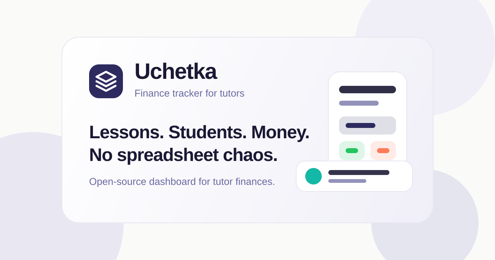

<a href="https://devglobe.app/projects/uchetka?utm_source=badge&utm_medium=embed" target="_blank" rel="noopener">
  
</a>

# Uchetka

Open-source finance dashboard for tutors. Lessons, students, payments, expenses, and income tracking — without spreadsheet chaos.



## What it does

- Track students, lesson history, schedules, and payment status.
- See income, expenses, planned revenue, and net results in one dashboard.
- Manage one-time and recurring transactions.
- Ask the AI assistant about your schedule, debts, conflicts and finances, plan lessons and homework, and get a morning digest. It can also propose changes that you confirm.
- Dictate to the assistant by voice.
- Work with multiple currencies: USD, EUR, RUB, GBP, UAH, KZT, TRY, PLN, USDT, USDC.
- Use auth, protected pages, and first-party cookies via the web reverse proxy.
- Run locally with PostgreSQL and Redis through Docker Compose.

## Stack

- Turborepo + pnpm workspaces
- `apps/web` — Astro 5 SSR, React 19 islands, Tailwind v4, shadcn/ui
- `apps/api` — NestJS 11 REST API, Drizzle ORM, Better Auth
- `apps/mobile` — Expo 54 native app (expo-router)
- `packages/shared` — Zod schemas, currency and money helpers
- `packages/auth` — shared Better Auth factory, email templates, auth client
- PostgreSQL 17 + Redis 7 via Docker Compose

## Run locally

Requirements:

- Node.js 22+
- pnpm 10+
- Docker

```bash
cp .env.example .env
pnpm run setup        # `pnpm setup` is a pnpm builtin, use `run`
pnpm db:up            # ports: POSTGRES_PORT / REDIS_PORT if 5432/6379 are taken
pnpm db:migrate
pnpm db:seed # optional demo data: demo@tutor.local / demo12345
pnpm dev
```

Web: http://localhost:4321  
API: http://localhost:3000

## AI assistant

The assistant is optimized for **ChatGPT**: you sign in with your ChatGPT Plus/Pro account ("Continue with ChatGPT") and it runs on your plan's usage, so there are no extra AI costs. This uses OpenAI's Sign in with ChatGPT plan usage for open-source, self-hosted apps, so each deployment is meant for its owner (and family), not as a public multi-user service.

Setup:

1. Set `AI_TOKEN_ENCRYPTION_KEY` (`openssl rand -base64 32`) and `CHATGPT_HOST_ID` (`echo "urn:uuid:$(uuidgen | tr A-Z a-z)"`, once per deployment, before the first sign-in).
2. On a remote server, set `CHATGPT_REDIRECT_URI=http://127.0.0.1:<API_PORT>/auth/callback`. After signing in, the browser ends on a 127.0.0.1 page that won't load. Paste its address into Settings → Integrations → AI assistant.
3. Open Settings → Integrations → AI assistant, accept the data-sharing notice and click **Continue with ChatGPT**.

Optional settings: `AI_MODEL` (default `gpt-6.1-sol`), `AI_CHAT_EFFORT` (`medium`), `AI_DIGEST_EFFORT` (`low`), `AI_DIGEST_HOUR` (local hour of the morning digest, default `7`).

**Voice input needs a separate OpenAI API key.** ChatGPT plan usage doesn't cover audio transcription, so dictation uses `gpt-transcribe` through the regular OpenAI API, billed per minute of audio on your OpenAI Platform account. Set `OPENAI_API_KEY`; without it, the mic button is hidden. The same key is also used as a fallback for chat when ChatGPT isn't connected.

Student names, lessons, notes, payments and voice recordings are sent to OpenAI only after you accept the notice in the app.

## Self-host (family) on a home server

Private instance for a few people with Sign in with ChatGPT enabled. Runs on any Docker host (x86 or ARM, e.g. CasaOS) and is exposed through a Cloudflare Tunnel, so no ports are opened on the router.

Prerequisites: Docker with Compose v2.24+, git, a Cloudflare account with the `myuchetka.com` zone.

1. Clone and configure:

   ```bash
   git clone <repo-url> uchetka && cd uchetka
   cp .env.family.example .env.family
   openssl rand -base64 32                       # BETTER_AUTH_SECRET
   openssl rand -base64 32                       # AI_TOKEN_ENCRYPTION_KEY
   openssl rand -hex 24                          # POSTGRES_PASSWORD (hex keeps DATABASE_URL valid)
   echo "urn:uuid:$(cat /proc/sys/kernel/random/uuid)"  # CHATGPT_HOST_ID, set once
   ```

   Fill `.env.family`: the secrets above, `AUTH_ALLOWED_EMAILS` (comma-separated, only these can register), email provider, `OPENAI_API_KEY` for voice.

2. Cloudflare: Zero Trust → Networks → Tunnels → Create a tunnel (Cloudflared), copy the token into `CLOUDFLARE_TUNNEL_TOKEN`. Add public hostnames:
   - `family.myuchetka.com` → `http://web:4321`
   - `family-api.myuchetka.com` → `http://api:3000`

3. Backups dir (the backup container writes as uid 999):

   ```bash
   mkdir -p backups && sudo chown -R 999:999 backups
   ```

4. Start:

   ```bash
   docker compose -f docker/compose.family.yml --env-file .env.family up -d --build
   ```

   Migrations run on API start. Update: `git pull` and run the same command.

Backups: daily dumps in `BACKUP_DIR` (absolute, or relative to `docker/`; default is `backups/` in the repo root), keeping 7 daily, 4 weekly and 6 monthly. Run one now with `docker compose -f docker/compose.family.yml --env-file .env.family exec backup /backup.sh`. Restore:

```bash
C="docker compose -f docker/compose.family.yml --env-file .env.family"
$C stop api web
$C exec -T postgres sh -c 'dropdb -U "$POSTGRES_USER" "$POSTGRES_DB" && createdb -U "$POSTGRES_USER" "$POSTGRES_DB"'
gunzip -c backups/last/tutor_finance-latest.sql.gz | $C exec -T postgres sh -c 'psql -U "$POSTGRES_USER" -d "$POSTGRES_DB"'
$C start api web
```

iOS app ("Uchetka Family", talks to `family-api.myuchetka.com`):

```bash
cd apps/mobile
eas build -p ios --profile family
eas submit -p ios --profile family
```

Then add the family members as internal testers in App Store Connect → TestFlight.

## Useful commands

```bash
pnpm dev              # run API and web in parallel
pnpm build            # build all workspaces
pnpm lint             # ESLint across the monorepo
pnpm typecheck        # TypeScript checks
pnpm format           # Prettier

pnpm db:up            # start PostgreSQL + Redis
pnpm db:down          # stop local services
pnpm db:migrate       # apply migrations
pnpm db:generate      # generate migrations from Drizzle schema
pnpm db:seed          # seed demo data
pnpm db:auth:generate # regenerate Better Auth tables
```

## Project structure

```txt
apps/api/        NestJS API
apps/web/        Astro SSR web app + React islands
apps/mobile/     Expo native app
packages/auth/   Better Auth setup shared by API/web
packages/shared/ Zod schemas, shared types, money helpers
drizzle/         Generated migrations
scripts/         Migration and seed scripts
docker/          PostgreSQL + Redis compose setup
```

## Better Auth schema

Better Auth tables (`user`, `session`, `account`, `verification`) live in `packages/auth/src/schema.ts` and are included in Drizzle generation.

After changing auth config or upgrading Better Auth:

```bash
pnpm db:auth:generate
pnpm db:generate
pnpm db:migrate
```
